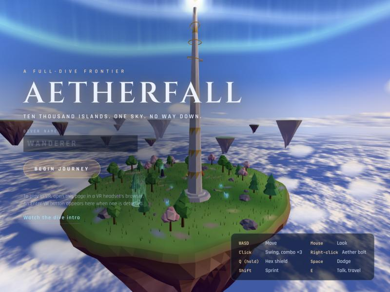
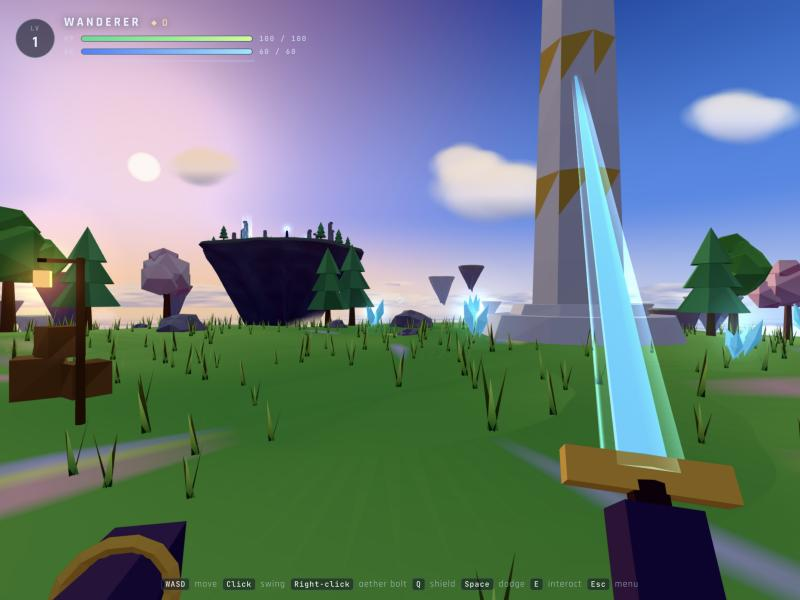
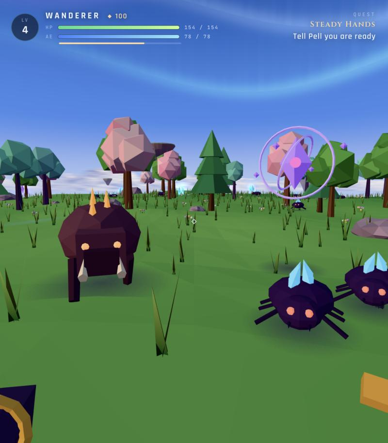
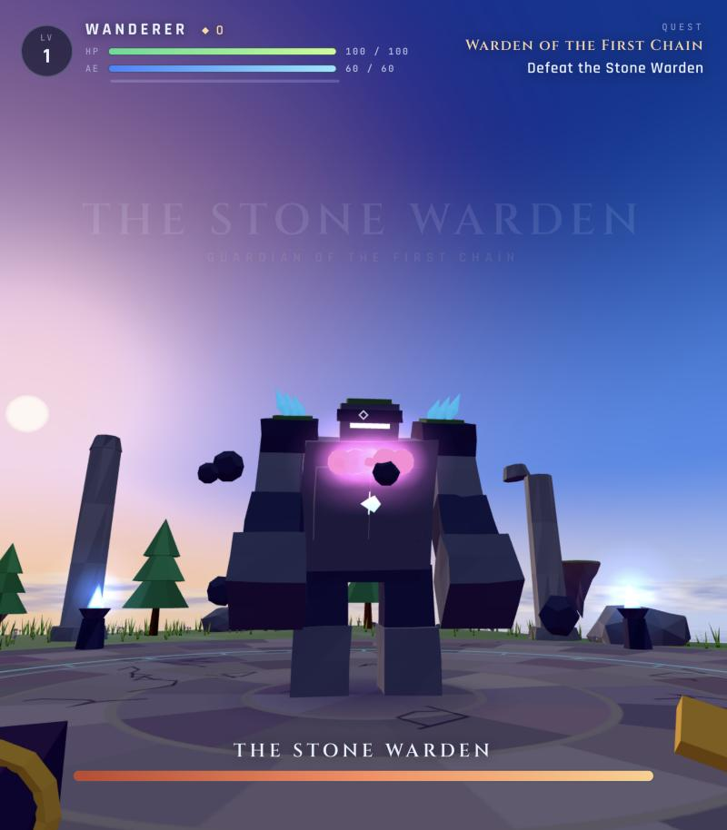

# Aetherfall

**A sky-island action RPG you can play in your browser, or in VR.**
Ten thousand islands. One sky. No way down.

### [▶ Play Aetherfall](https://adthocro123.github.io/aetherfall/) · [Watch the dive intro](https://adthocro123.github.io/aetherfall/intro.html)



You wake on Skyreach, a floating island high above a sea of clouds, and the logout button is gone.
Pell, a cartographer who has been stranded longer than you, thinks the Sky Keys guarded by the
Wardens might open a way out. Prove yourself on the training dummy, thin the swarm on Verdant Shelf,
then break the Stone Warden to claim the first key.

Everything is generated in code: the islands, creatures, music and sound effects. The repo has no
image, model or audio files apart from the screenshots below.

## How to play

### In your browser (nothing to install)

1. Open **https://adthocro123.github.io/aetherfall/** on a computer, in Chrome, Edge, Safari or Firefox.
2. Type a diver name and press **Begin journey**.
3. Click the game once so it can capture your mouse. Press **Esc** any time for the menu.

Your progress saves automatically in that browser. Use headphones: the score is synthesized live.

### In VR

The game supports WebXR headsets. In VR the blade is in your right hand and you swing it for real;
harder swings hit harder.

1. Put on the headset and open its browser (Meta Quest Browser, or Chrome or Edge for a PC VR headset).
2. Go to **https://adthocro123.github.io/aetherfall/**.
3. Press **Enter VR**. The button only appears in a browser that supports VR.

VR mode has not been tested on a real headset yet. If the blade sits at an odd angle in your hand,
press **Y** and change **Sword angle**.

### On your own computer

You need [Node.js](https://nodejs.org) 18 or newer. Then:

```bash
git clone https://github.com/adthocro123/aetherfall.git
```

```bash
cd aetherfall
```

```bash
npm start
```

Open http://localhost:8080. Opening `index.html` by double-clicking won't work, because browsers
block the game's code modules on pages loaded straight from disk.

To try your local copy in a headset on the same Wi-Fi, run `npm run vr` instead and open the
`https://` address it prints in the headset's browser. The browser warns about the certificate
once; choose Advanced, then Proceed.

## Controls

### Keyboard and mouse

| Key | Action |
| --- | --- |
| W A S D | Move |
| Mouse | Look |
| Click | Swing the blade. Click again quickly for a 3-hit combo; the third hit is heavy |
| Right-click | Aether bolt (costs AE, homes in a little) |
| Q (hold) | Hex shield: blocks hits and orbs from the front, drains AE |
| Space | Dodge, with a moment of invulnerability |
| Shift | Sprint |
| E | Talk, ride an aether current, rest at a waystone |
| 1 / 2 / 3 | Pick a reply in a conversation |
| Esc | Menu: volume, mouse sensitivity, invert Y |

### VR controllers

| Control | Action |
| --- | --- |
| Left stick | Move |
| Right stick | Snap turn |
| Swing your right hand | Sword |
| Left trigger | Aether bolt |
| Left grip (hold) | Hex shield |
| A | Talk, travel, confirm |
| B | Dodge while moving |
| Y | Menu: snap angle, comfort vignette, sword angle, exit VR |
| Look at your left wrist | Health, aether, level and current quest |

## Tips

- Swing through an orb just before it hits you to send it back at whoever fired it.
- Thornbacks paw the ground before they charge. Step aside and they crash into trees, dazed and open.
- The Stone Warden shrugs off ordinary hits. Make it slam the ground, then strike the glowing core in its chest.
- Creatures drop shards. Pell uses them to temper your blade; there are four tiers.
- Fall off an island and the sky throws you back to the last waystone you rested at.

## Screenshots

| Skyreach | Verdant Shelf | The Stone Warden |
| --- | --- | --- |
|  |  |  |

## Changing the game

There is no build step: edit a file, then reload the page. `npm start` serves the folder with no cache.

| Path | What's in it |
| --- | --- |
| `index.html` | The game page |
| `intro.html` | The opening cinematic. Its "Begin journey" carries your diver name into the game |
| `src/main.js` | Game states, travel between islands, saving, the frame loop |
| `src/world/` | Island generator, props, the sky, and where everything is placed |
| `src/player/` | Movement, stats, the sword and shield |
| `src/enemies/` | Skitter, Thornback, Shardling and the Stone Warden |
| `src/combat/` | Hit detection, projectiles, particles, damage numbers |
| `src/game/` | Quests, Pell and her dialogue, save data |
| `src/ui/` | HUD, in-world panels, styles |
| `src/vr/xr.js` | The WebXR session and controllers |
| `src/core/` | Audio synth and music, input, textures, math helpers |
| `tools/serve.mjs` | The local server (no dependencies) |

Pushing to `main` updates the online version at the link above within a minute or two.

## Built with

- [three.js](https://threejs.org) r170 (MIT license), loaded from jsDelivr
- Fonts: Cinzel, Rajdhani and JetBrains Mono from Google Fonts (SIL Open Font License)
- Web Audio for every sound and note of music
