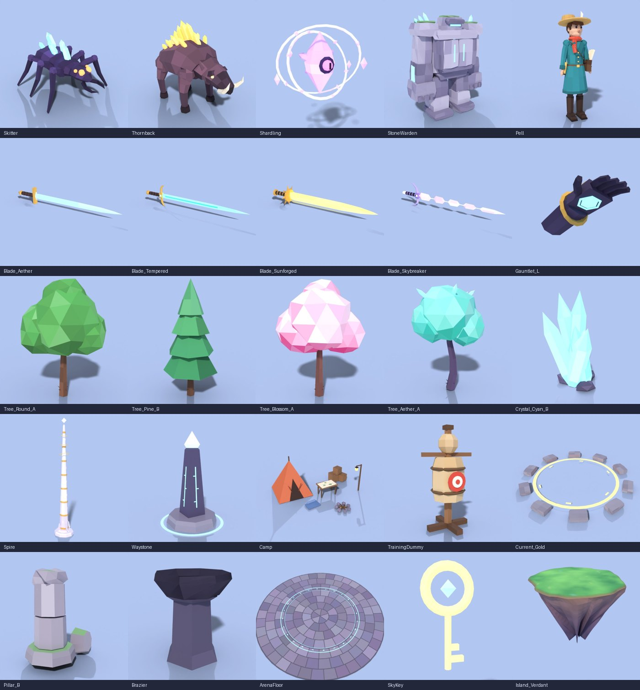

# Aetherfall art

Every 3D asset for the Unity version of Aetherfall, generated by Python scripts in Blender. The models keep the web
game's low-poly, flat-shaded look and its palette, and add real modelling, rigs and animation.



## What's here

| Folder | Contents |
| --- | --- |
| `export/fbx/` | One FBX per asset, for Unity |
| `export/glb/` | The same as glTF binaries, for the web and quick viewing |
| `export/meta/` | Per-asset notes: animation clips, sockets, hit spheres, colliders, triangle counts |
| `export/layout.json` | Where every island, prop, tree, rock, tuft, spawn and travel point goes, in Unity space |
| `blend/` | Editable Blender files |
| `previews/` | A render of each asset, and for animated ones a strip with five frames of every clip |
| `assets/` | The scripts that build everything, one module per group |
| `lib/` | Shared helpers: mesh building, colours, rigs and clips, export, previews |

### Assets

| Group | Assets |
| --- | --- |
| creatures | `Skitter` (7 clips), `Thornback` (10), `Shardling` (5), `StoneWarden` (14), `WardenRocks` |
| characters | `Pell` (Unity Humanoid rig; Idle, Talk, Wave) |
| gear | `Blade_Aether`, `Blade_Tempered`, `Blade_Sunforged`, `Blade_Skybreaker`, `Gauntlet_R`, `Gauntlet_L`, `HexShield` |
| nature | `Tree_Round/Pine/Blossom/Aether_A/B`, `Rock_A`-`D`, `Rock_Mossy_A/B`, `Crystal_Cyan_A/B`, `Crystal_Violet_A/B`, `Grass_A`, `Flowers_A` |
| structures | `Spire`, `Waystone`, `Camp`, `TrainingDummy`, `Current_Blue`, `Current_Gold`, `Pillar_A`-`C`, `Brazier`, `ArenaFloor`, `SkyKey` |
| islands | `Island_Skyreach`, `Island_Verdant`, `Island_Warden`, `FarIslands`, and `WorldLayout` (writes `layout.json`) |

## Rebuilding

With Blender 5.3 (the version these were built and tested with; older versions are untested):

```bash
blender -b -P art/build.py -- Skitter
```

Or with Blender as a Python module (Python 3.13):

```bash
pip install bpy==5.3.0 pillow
```

```bash
python art/build.py creatures --no-preview
```

Previews need Pillow; Blender's bundled Python doesn't have it, so inside Blender the build skips them unless you
install it there. Arguments are asset names or group names; with none it builds everything. `--out DIR` writes the exports somewhere
else (for example straight into the Unity project), and `--list` lists every asset.

To change an asset, edit its function in `assets/` and rebuild it; the `.blend` files are outputs and are overwritten.
For hand edits, open the `.blend`, change it, and export the FBX from Blender yourself, keeping the settings in
`lib/export.py`.

## Conventions

- **Units and axes:** metres, Z up in Blender. Models face **-Y** in Blender, which becomes **+Z (forward) in Unity**.
  Pivots sit on the ground (the Shardling's is at its centre: it hovers 2.4 m up; blades and gauntlets are centred on the grip).
- **Colour:** one vertex colour per face in the `Col` attribute. RGB is the colour; **alpha is an emission factor**
  (0 = matte, 1 = full glow). All meshes use the `AF_VertexColor` material, except glow shells and the shield, which use
  `AF_Glow`. Unity remaps both to two small shaders described in `docs/unity-port.md`.
- **Rigs:** creatures use Generic rigs rooted at a `Root` bone, with no root motion. Pell's bones use Unity's
  HumanBodyBones names in a T-pose, so they map to a Humanoid avatar automatically.
- **Clips** are exported as FBX takes named `<Model>|<Clip>`; each clip's length, loop flag and gameplay timing are in its meta JSON.
- **Positions in the meta and layout files are in Unity space**, converted from Blender (x, y, z) to (-x, z, -y), and from
  the web game's three.js (x, y, z) to (-x, y, z).

## How the islands match the web game

`assets/islands.py` is an exact port of `src/core/util.js` (the 32-bit random number generator, hash and noise),
`src/world/island.js` and the placement code in `src/world/world.js` and `src/world/sky.js`. It was checked against
the running web game: the random sequences, noise values, island heights and edges, the instance counts of every
scattered prop, and the position of every current, waystone, landing point and Pell all match.
